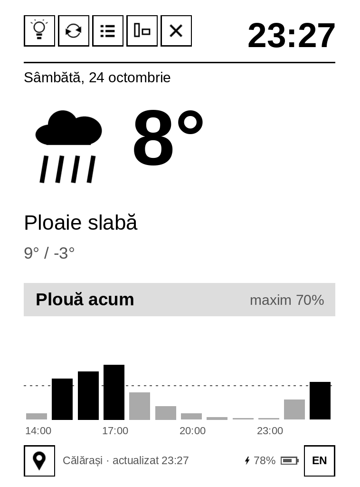
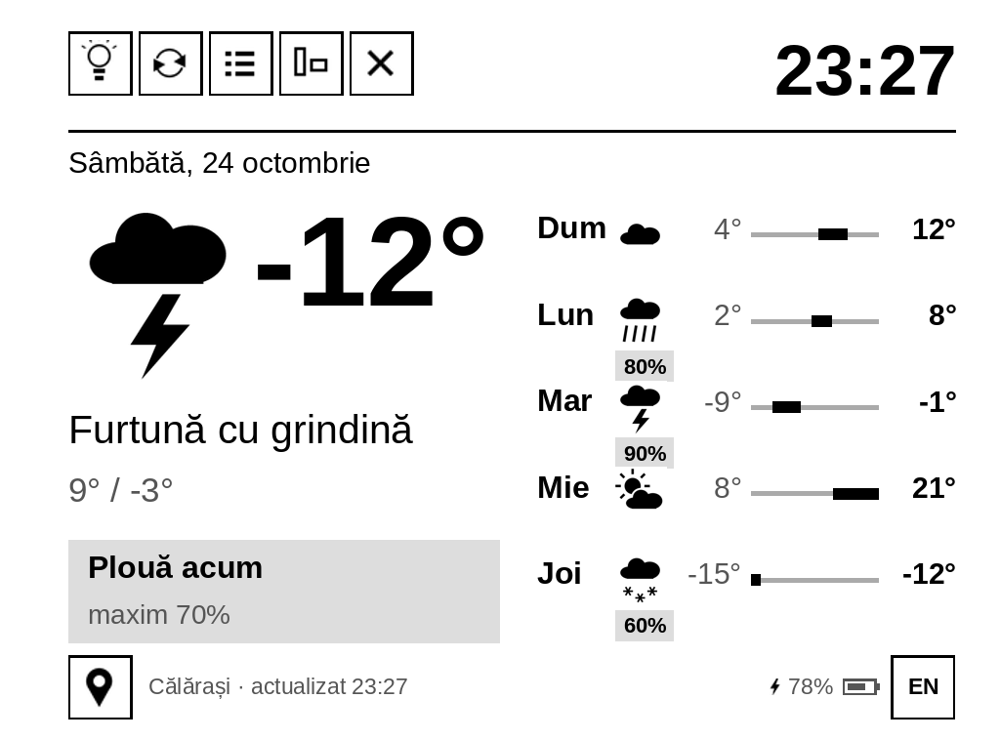
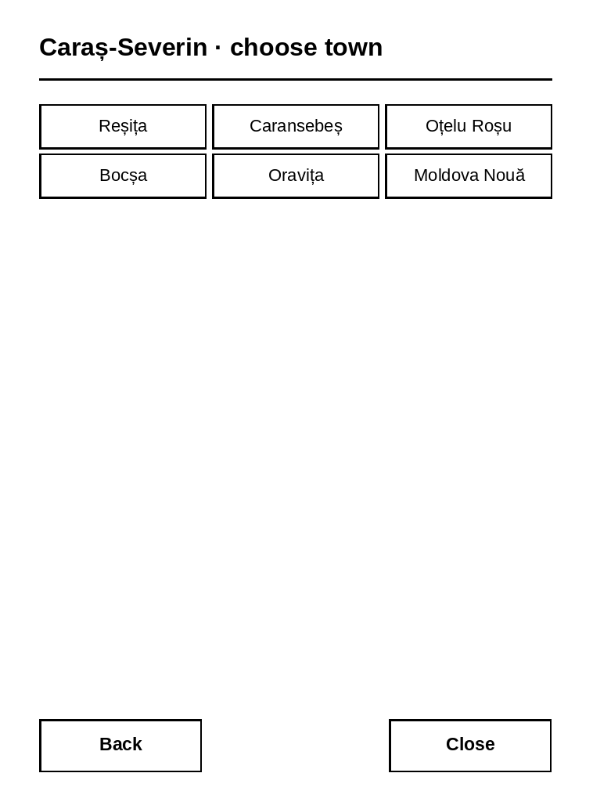
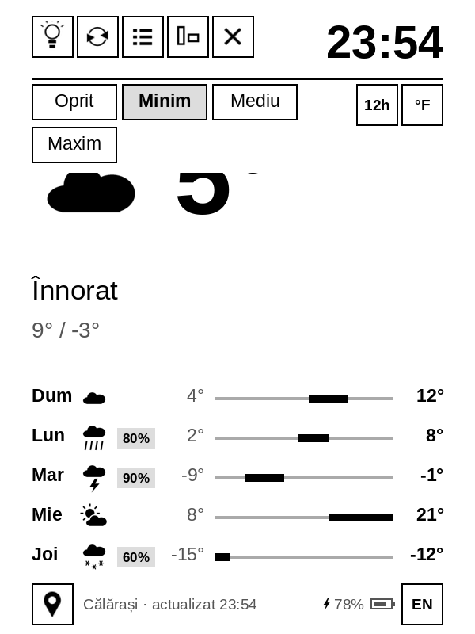

# Kindle Weather Clock (RO)

Turn an old Kindle Paperwhite into a **weather and clock display**. It runs on the Kindle itself. No server, no extra hardware.

   

*The pictures are PC previews of the screen.*

## Features
- Weather from [Open-Meteo](https://open-meteo.com) (free, no key): temperature, conditions, rain banner and hourly chart, 5-day forecast.
- Portrait and landscape, with a flip for charging cable up or down.
- Touch buttons: light (Off / Min / Medium / Max), flip, view, rotate, exit.
- City picker: county, then town. Favorites on top. Edit `cities.txt` to add more.
- Romanian and American English, 12h/24h clock, °C/°F.
- Hides the Kindle status bar. Updates the clock every minute without flashing.

## Install
See [docs/INSTALL.md](docs/INSTALL.md). Short version: jailbreak the Kindle, copy `extensions/rekindle` to it, open KUAL > "Ceas și vreme".

Tested on a **Kindle Paperwhite 1, firmware 5.6.1.1**.

## How it was made
The story and the steps are in [docs/project-summary.pdf](docs/project-summary.pdf) and [docs/project-diagram.png](docs/project-diagram.png).

## Credits
Built on the open-source [rekindle](https://github.com/Chaozhuang22/rekindle) project. The jailbreak was learned from the [Oak Reef guide](https://oakreef.ie/bog/kindle-jailbreaking). Thanks also to KindleModding, MobileRead, NiLuJe (FBInk) and Open-Meteo. Full list: [CREDITS.md](CREDITS.md).

Design and ideas: the project owner. Code: Claude (Anthropic's AI assistant).

## License
[MIT](LICENSE). The font is under the SIL OFL 1.1. Jailbreaking is at your own risk.

---

## Informare în limba română

Acest proiect a fost creat de cineva din România, din dorința de a refolosi un vechi Kindle Paperwhite care stătea aruncat într-un sertar.

Ideea a pornit de la proiectul open-source **rekindle**. Designul și ideile îi aparțin autorului proiectului. Codul a fost scris de Claude, asistentul AI al companiei Anthropic, pe baza cererilor lui. Totul a fost testat pe un Kindle real.

Mulțumiri tuturor celor care au creat și au dat gratuit uneltele de care depinde proiectul: rekindle, Oak Reef, KindleModding, MobileRead, NiLuJe (FBInk) și Open-Meteo.

Instalarea e descrisă în [docs/INSTALL.md](docs/INSTALL.md) (în engleză). Pe scurt: faci jailbreak, copiezi folderul `extensions/rekindle` pe Kindle și pornești din KUAL meniul „Ceas și vreme". În `rekindle.conf` schimbi locația. Orașul îl alegi din butonul cu pin, din partea de jos a ecranului.
