# Meteo Alarm Kindle

Turn an old **Kindle Paperwhite 1** into a **weather clock with official weather warnings**. It runs on the Kindle itself. No server, no extra hardware, no API key.

**Latest version: v2.062** · [Download the zip](download/MeteoAlarmKindle-v2.062.zip?raw=1) · [Changelog](docs/CHANGELOG.md) · [Install](docs/INSTALL.md) · [Română](#în-limba-română)

  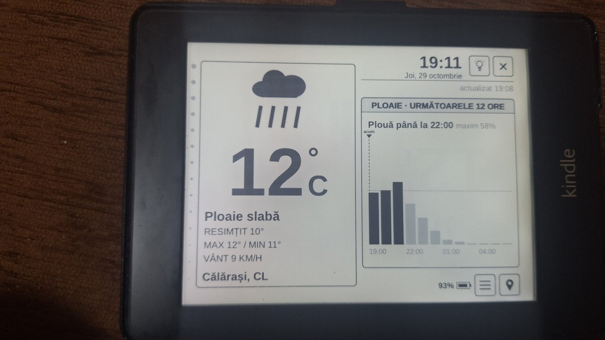
  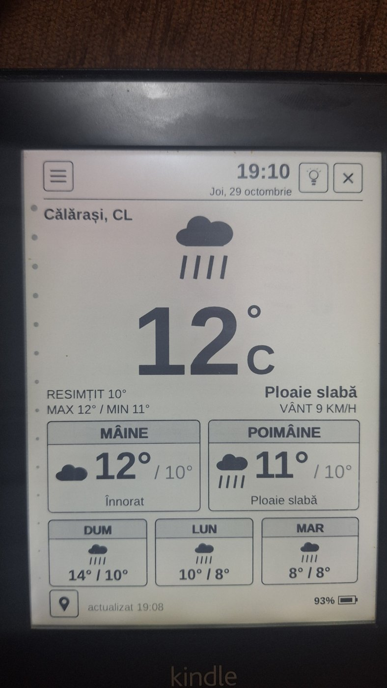

*Photos of the real Kindle Paperwhite 1, October 2026.*

## Video

[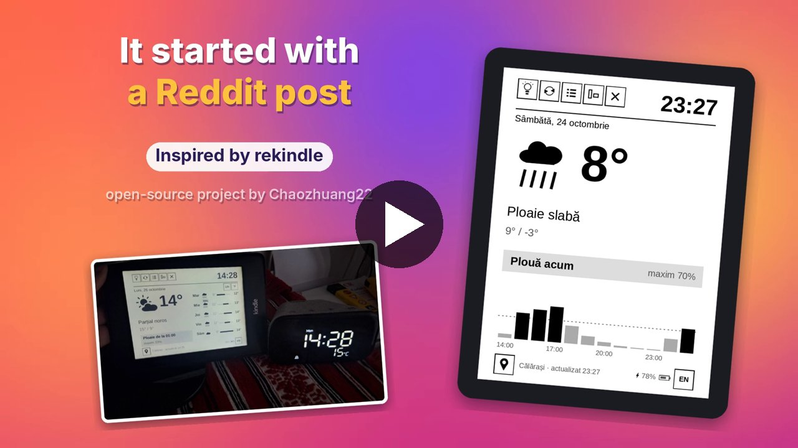](docs/video/MeteoAlarmKindle-promo-16x9.mp4)

*28 seconds, 16:9, English voice. Click the picture to open the video.*

## Features

- **Weather now and ahead** from [Open-Meteo](https://open-meteo.com) (DWD ICON model): big temperature, icon, description, feels like, high/low, wind.
- **Rain and snow chart** for the next 12 hours, with a "now" marker.
- **Two views**: simple, or a 5-day list. **Portrait or landscape**, and a 180° flip for the cable.
- **MeteoAlarm warnings** (ANM, Romania) for your county: yellow, orange and red codes, up to two at once, shown as gray shades on e-ink.
- **Sun, UV index and pollen** boxes in landscape. The UV index comes from the Open-Meteo air quality service and shows in the daytime under a clear or partly cloudy sky; otherwise the box shows humidity. In the simple view the boxes take turns every 15 minutes with **Moon (rise/set), Pressure and Air quality (European AQI)**.
- **315 towns** in all 41 counties and Bucharest. The city shows its county code ("Călărași, CL"). The **favourites are the last 3 cities you chose**. Add your own in `cities.txt`.
- **One ☰ menu**: orientation, view, rotate, refresh, °C/°F, 12h/24h, Romanian/English. The last used choice moves to the top.
- **Front light**: swipe up or down on the left edge, like a Kobo. The light button shows a 24-step light bar. Auto light at sunset, at night and on low battery. At 21% battery a lit light blinks 4 times, goes off, and the auto light pauses until the battery is back at 50%.
- Pop-ups close at once and the clock updates every minute without flashing. A full refresh every 15 minutes clears e-ink ghosting.
- Battery status, and the weather is fetched every 15 minutes (every hour at night).

## Screens

| Portrait, 5 days | Portrait, winter | ☰ menu | City picker |
|---|---|---|---|
| 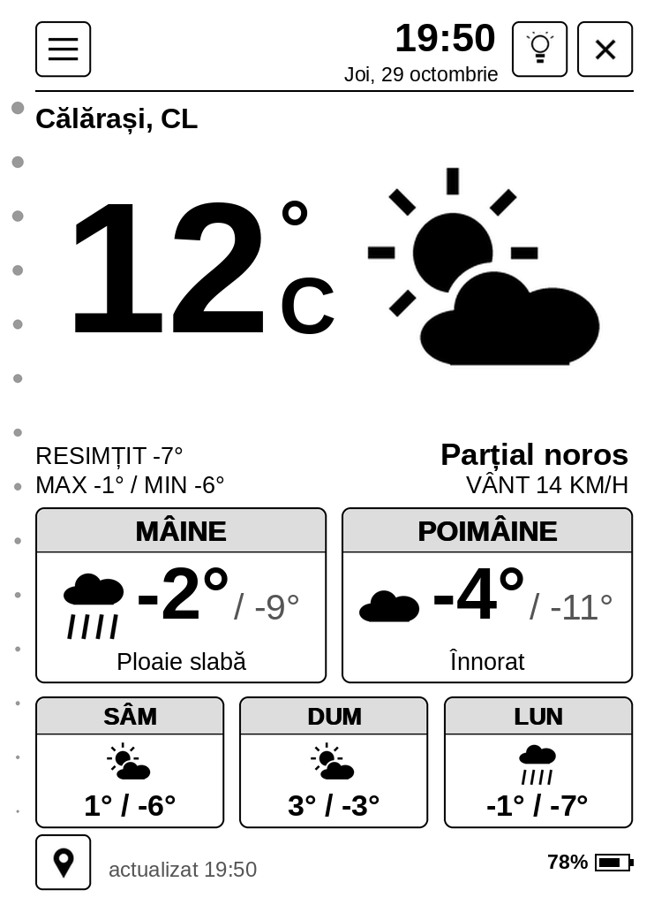 |  | 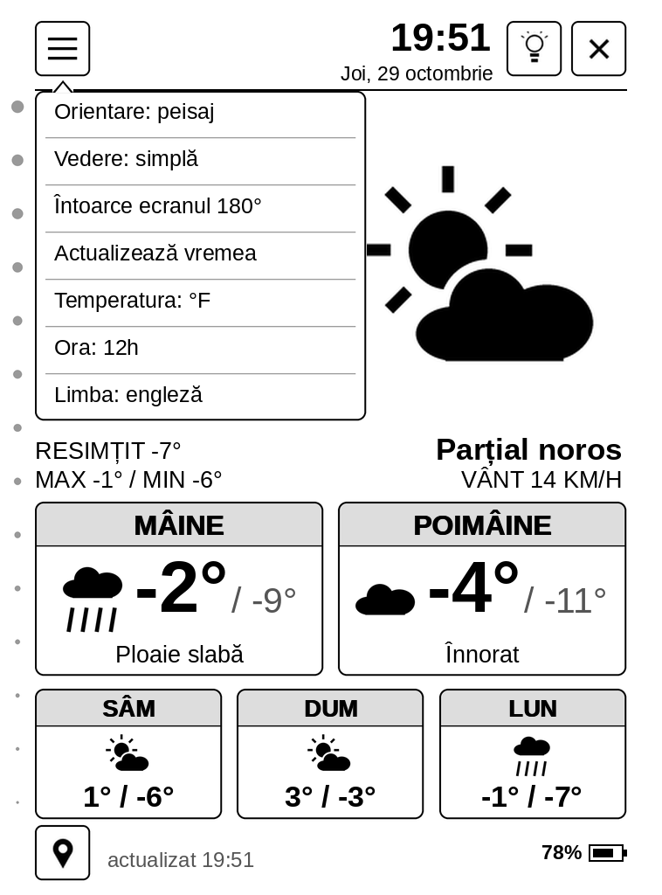 | 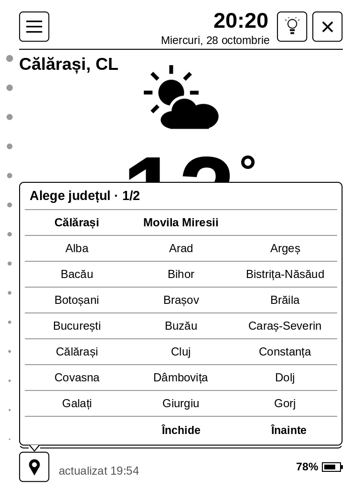 |

| Landscape, 5 days with warnings | Landscape, rain with warnings |
|---|---|
| 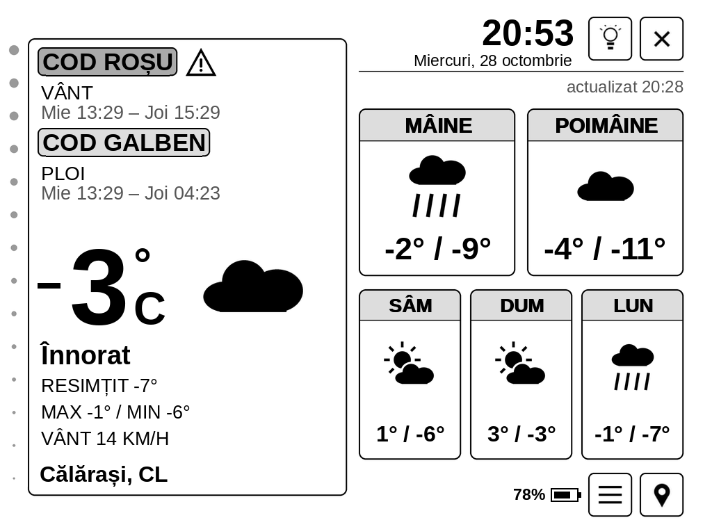 | 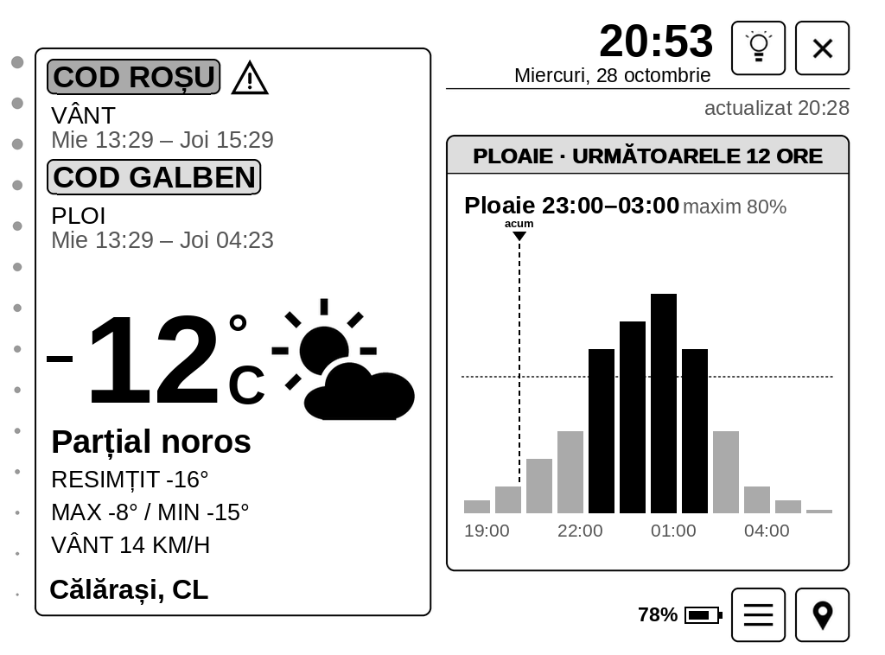 |

| Landscape, Sun / UV / Pollen | Landscape, Moon / Pressure / AQI (every other 15 min) |
|---|---|
| 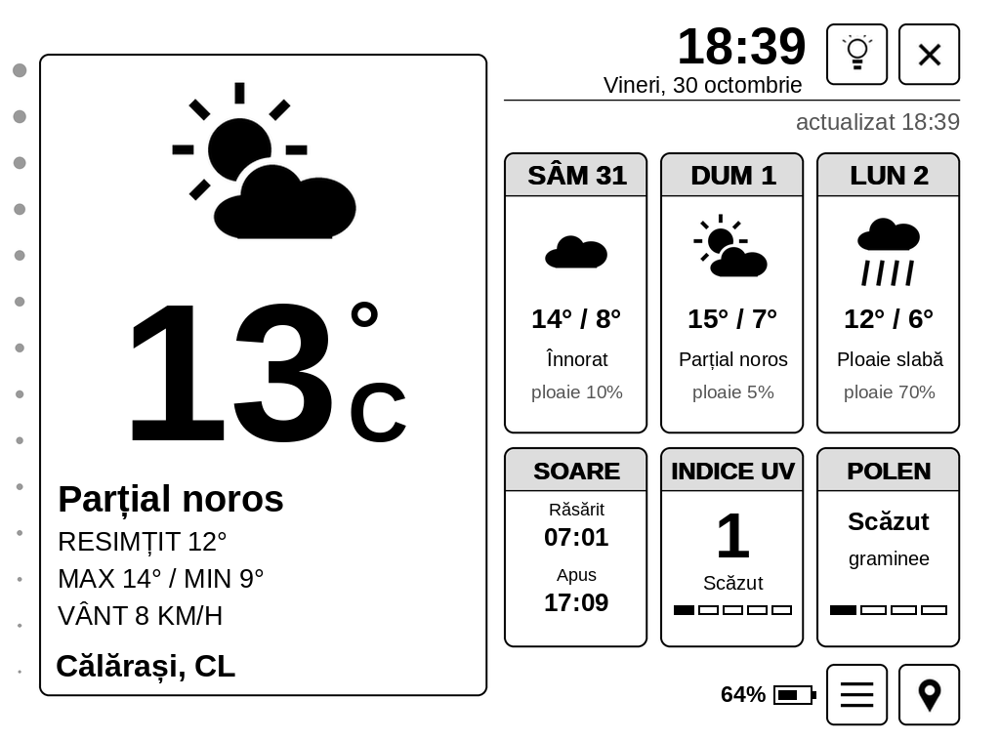 | 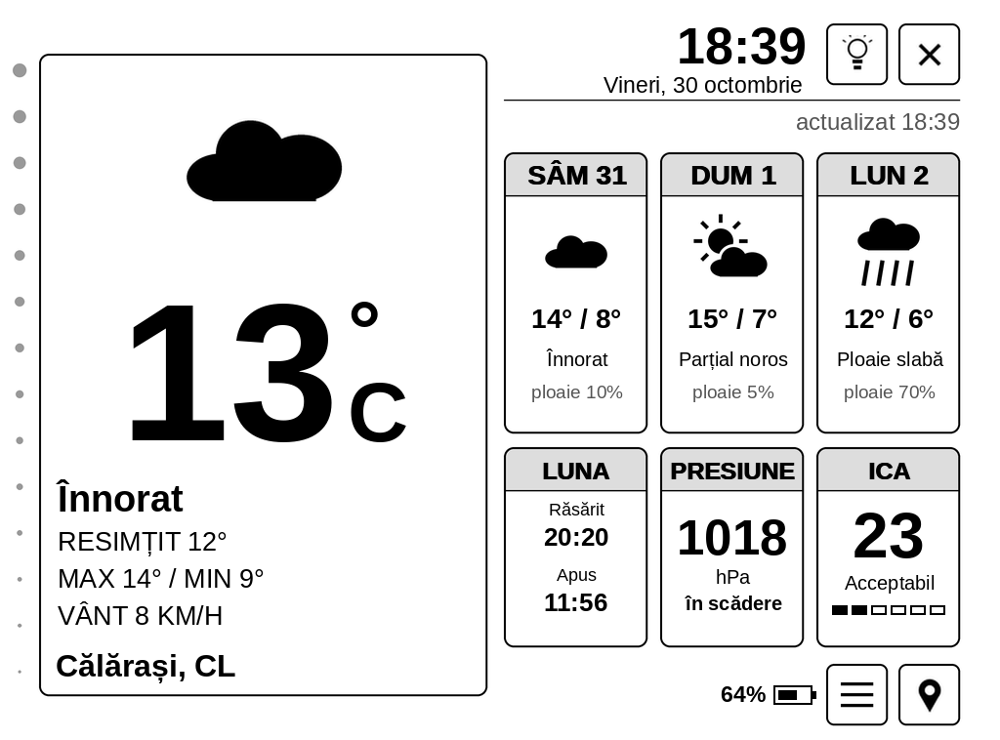 |

*These screens are PC previews drawn by the same script.*

  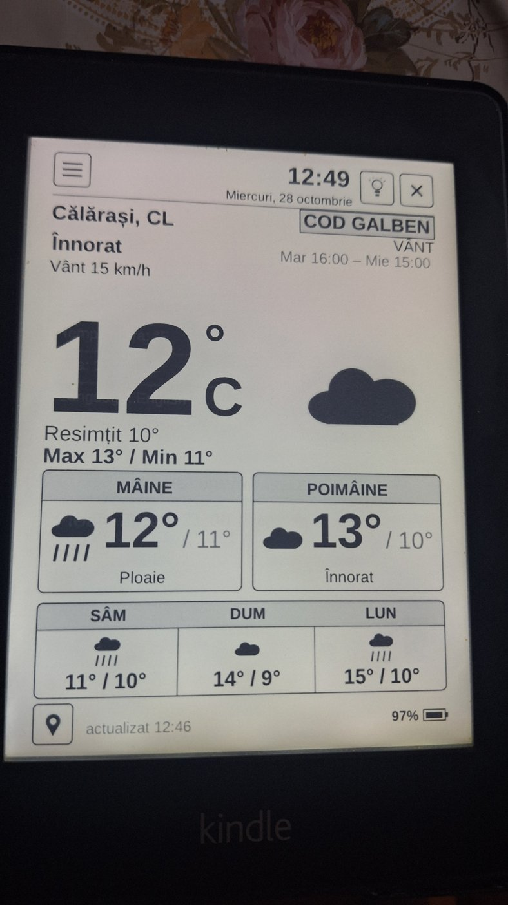
  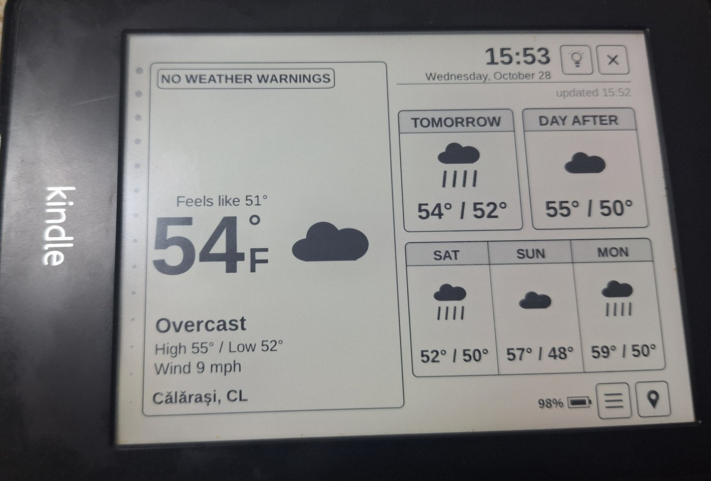

*On the real Kindle: a yellow wind warning, and the English / °F mode.*

## Install

Short version: jailbreak the Kindle, install KUAL, copy the `extensions` folder from the [v2.062 zip](download/MeteoAlarmKindle-v2.062.zip?raw=1) to the Kindle root, then open **KUAL > Meteo Alarm Kindle**. Full steps: [docs/INSTALL.md](docs/INSTALL.md).

Tested on a **Kindle Paperwhite 1, firmware 5.6.1.1**. Each 2.0x version was tested on the Kindle. 2.062 is new and was checked with PC previews.

## Lock screen add-on

[Meteo Alarm Kindle Screensaver](https://github.com/viorelrb-alt/meteo-alarm-kindle-screensaver-ro) turns off the lock screen ads and shows a Meteo Alarm Kindle screen instead. It also keeps the Kindle's clock on Romanian time.

## How it was made

It started with a Reddit post about [rekindle](https://github.com/Chaozhuang22/rekindle). Version by version, it grew into a new app with a new interface.

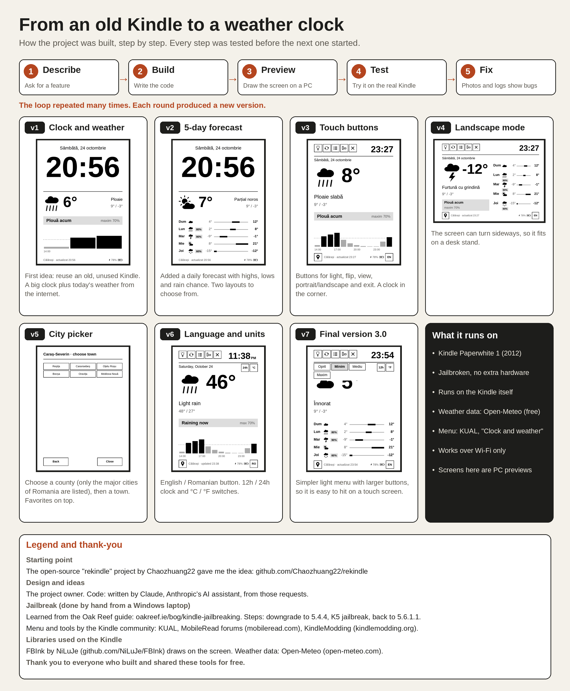

The whole story is in [docs/project-summary.pdf](docs/project-summary.pdf) ([română](docs/project-summary-RO.pdf)) and in the [changelog](docs/CHANGELOG.md).

## Credits

Built on the open-source [rekindle](https://github.com/Chaozhuang22/rekindle) project by **Chaozhuang22** (MIT). The jailbreak was learned from the [Oak Reef guide](https://oakreef.ie/bog/kindle-jailbreaking). Thanks also to KindleModding, MobileRead, NiLuJe (FBInk), Open-Meteo, MeteoAlarm and ANM. Full list: [CREDITS.md](CREDITS.md).

Design, ideas and testing on the Kindle: the project owner (Romania). Code: Claude (Anthropic's AI assistant).

## License

[MIT](LICENSE). The font is under the SIL OFL 1.1. Jailbreaking is at your own risk.

---

## În limba română

**Meteo Alarm Kindle** transformă un Kindle Paperwhite 1 vechi într-un ceas cu vremea și cu avertizările meteo oficiale. Rulează pe Kindle, fără server și fără cheie API.

Ce face:
- Vremea acum și pe 5 zile (Open-Meteo), cu graficul de ploaie pe 12 ore.
- Avertizările MeteoAlarm (ANM) pentru județul tău: cod galben, portocaliu și roșu.
- Portret sau peisaj, vedere simplă sau listă pe 5 zile.
- 315 localități din toate cele 41 de județe și București. Favoritele sunt ultimele 3 localități alese.
- Meniul ☰: orientare, vedere, rotire, actualizare, °C/°F, 12h/24h, română/engleză.
- În peisaj: Soare / UV / Polen. UV-ul vine de la serviciul de calitate a aerului și apare ziua, la Senin, Predominant senin sau Parțial noros; altfel apare Umiditatea. În vederea simplă, casetele alternează la 15 minute cu Lună / Presiune / ICA (indicele european de calitate a aerului).
- Lumina se reglează glisând pe marginea stângă, ca pe Kobo. La 21% baterie, lumina clipește de 4 ori, se stinge, iar aprinderea automată stă pe pauză până la 50%.

Instalare: faci jailbreak, instalezi KUAL, copiezi folderul `extensions` din [arhiva v2.062](download/MeteoAlarmKindle-v2.062.zip?raw=1) în rădăcina Kindle-ului și pornești din KUAL meniul „Meteo Alarm Kindle”. Dacă ai avut o versiune veche, șterge folderul `extensions/rekindle`. Detalii în `extensions/meteoalarmkindle/CITESTE.txt`.

Proiectul a fost creat de cineva din România, ca să refolosească un Kindle vechi uitat într-un sertar. A pornit de la proiectul open-source **rekindle** (Chaozhuang22). Designul, ideile și testele pe Kindle îi aparțin autorului. Codul a fost scris de Claude, asistentul AI al companiei Anthropic.

Ecranul de repaus fără reclame e un proiect separat: [meteo-alarm-kindle-screensaver-ro](https://github.com/viorelrb-alt/meteo-alarm-kindle-screensaver-ro).

Povestea completă a proiectului, în română: [docs/project-summary-RO.pdf](docs/project-summary-RO.pdf).

Mulțumiri tuturor celor care au creat și au dat gratuit uneltele de care depinde proiectul: rekindle, Oak Reef, KindleModding, MobileRead, NiLuJe (FBInk), Open-Meteo, MeteoAlarm și ANM.
