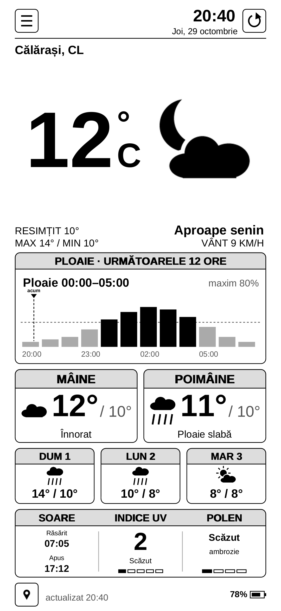

# Meteo Alarm Android v0.1 (test)

The Meteo Alarm Kindle portrait screen ported to an Android phone, kept black and white like the
Kindle and laid out for a tall screen (made for a Samsung Galaxy A54, 1080x2340). Same data as the
Kindle: Open-Meteo (DWD ICON) forecast, MeteoAlarm warnings for the county, pollen, sun and UV.



*PC preview drawn by the same code with sample data (`./build.sh preview`).*

## What it does

- Full screen clock and weather, screen kept on (a ☰ menu option lets it sleep).
- Clock, date, city with county code, up to two MeteoAlarm warnings (yellow, orange, red).
- Big temperature and icon, feels like, high/low, wind.
- Rain and snow chart for the next 12 hours with the "now" marker.
- Tomorrow, the day after and three more days; sunrise/sunset, UV index and pollen.
- ☰ menu: refresh, choose town (the 315 towns of `cities.txt`, the last three as favourites),
  °C/°F, 12h/24h, Romanian/English, keep the screen on.
- Weather every 15 minutes while open (hourly at night), cached for offline start.

## Build

No Gradle and no Google SDK download needed; Ubuntu's Android tools are enough:

```sh
sudo apt-get install android-sdk-platform-23 aapt dalvik-exchange zipalign apksigner
./build.sh            # -> build/MeteoAlarmAndroid-v0.1.apk
./build.sh preview    # -> build/preview.png (draws the screen on a PC)
```

`debug.keystore` (password `android`) is a test key, kept here so later test versions install
over this one.

## Install on the phone

Copy the APK to the phone, open it from **My Files**, and allow **Install unknown apps** for that
app when asked. If Play Protect warns about an unknown developer, choose **Install anyway**.

## Code

- `src/ro/meteoalarm/android/core/`: plain Java, no Android: data (`Weather`, `Warnings`), texts
  and the screen drawing (`Screen`, on a 758-unit wide canvas like the Kindle's).
- `src/ro/meteoalarm/android/`: the Android activity, view and canvas.
- `preview/`: draws `Screen` with Java2D for a PNG preview.
